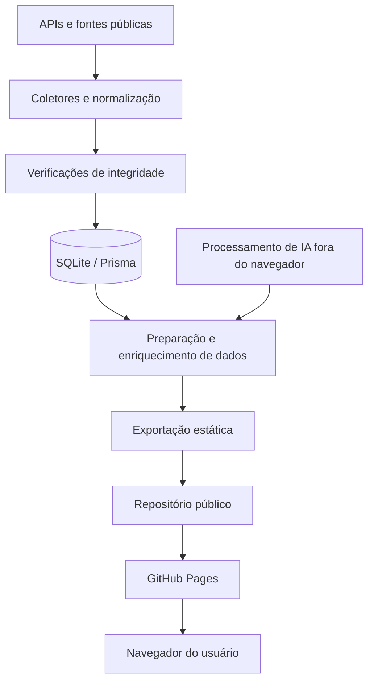

<div align="center">

# RUÍDO

### Plataforma independente de transparência e acompanhamento legislativo

**Dados públicos · Engenharia de dados · Automação · Tecnologia cívica**

[](https://ruido.runs-at.dev/)
[](./source/)
[](./source/package.json)
[](./source/package.json)
[](./source/package.json)

[**Plataforma**](https://ruido.runs-at.dev/) · [**Metodologia**](https://ruido.runs-at.dev/sobre/) · [**Cobertura**](https://ruido.runs-at.dev/cobertura/) · [**Código-fonte**](./source/) · [**Reportar problema**](https://github.com/leomoreiraa/ruido/issues)

</div>

---

## Índice

- [Visão geral](#visão-geral)
- [Funcionalidades](#funcionalidades)
- [Tecnologias](#tecnologias)
- [Arquitetura](#arquitetura)
- [Começando](#começando)
- [Executando localmente](#executando-localmente)
- [Scripts disponíveis](#scripts-disponíveis)
- [Estrutura do projeto](#estrutura-do-projeto)
- [Dados, fontes e integridade](#dados-fontes-e-integridade)
- [Publicação e segurança](#publicação-e-segurança)
- [Contribuições](#contribuições)
- [Licença e autoria](#licença-e-autoria)

## Visão geral

O **RUÍDO** é um projeto independente de tecnologia cívica que organiza registros públicos da política brasileira para facilitar a consulta, o acompanhamento e a fiscalização cidadã.

O sistema reúne dados institucionais e os apresenta em uma interface acessível, com contextualização e explicações assistidas por inteligência artificial. Seu objetivo é reduzir a distância entre informações governamentais dispersas e quem precisa compreendê-las.

**O projeto integra:**
- Desenvolvimento de aplicações web e interfaces responsivas;
- Integração e normalização de dados provenientes de APIs públicas;
- Rotinas automatizadas de coleta e atualização;
- Persistência estruturada e tratamento de dados incompletos;
- Geração de conteúdo explicativo com apoio de IA;
- Publicação estática e disponibilização de código para auditoria.

> **O dado é público. A leitura também deve ser.**

## Funcionalidades

| Módulo | Descrição |
| --- | --- |
| Parlamentares | Perfis e informações públicas de representantes |
| Pautas e proposições | Consulta de matérias e tramitações legislativas |
| Votações | Registros e detalhamento de votações conforme disponibilidade oficial |
| Presença | Indicadores baseados nos registros efetivamente disponibilizados |
| Emendas e informações financeiras | Consulta de dados associados a fontes públicas |
| IA explicativa | Apoio à compreensão de textos legislativos, sem substituir documentos oficiais |
| Cobertura | Indicação de limites, ausências e progresso da coleta |
| Interface responsiva | Navegação adaptada para dispositivos móveis e desktop |

A cobertura de cada módulo depende da disponibilidade e integridade das fontes de origem.

## Tecnologias

| Área | Stack |
| --- | --- |
| Aplicação web | Next.js 14, React 18, TypeScript |
| Estilização | Tailwind CSS |
| Interface | Lucide React, Radix UI |
| Backend e integração | Rotas de API, serviços TypeScript, scripts Node.js |
| Banco de dados | SQLite e Prisma ORM |
| Inteligência artificial | Processamento automatizado de conteúdo com IA |
| Automação | GitHub Actions no ambiente de operação |
| Publicação | Exportação estática e GitHub Pages |

A documentação técnica das dependências está disponível no código-fonte público.

## Arquitetura

O RUÍDO utiliza uma arquitetura em etapas para coleta, tratamento e apresentação de dados. A interface pública é disponibilizada por meio de arquivos estáticos.



### Decisões arquiteturais

**Separação de responsabilidades:** a coleta e o processamento não dependem de visitas ao site.

**Publicação estática:** os visitantes não recebem credenciais de APIs, conexão com banco operacional ou serviços de geração de conteúdo.

**Rastreabilidade:** o código-fonte pode ser consultado, enquanto a metodologia explicita limites e lacunas de cobertura.

**Atualizações progressivas:** novos registros podem ser incorporados por rotinas automatizadas, respeitando a disponibilidade das fontes.

## Começando

Existem **duas maneiras de explorar o projeto**: abrir o site já publicado ou clonar o código-fonte para estudo e desenvolvimento.

### Pré-requisitos

Para trabalhar com o código-fonte:

- [Git](https://git-scm.com/downloads);
- [Node.js](https://nodejs.org/) compatível com Next.js 14 (recomendado: Node.js 20 LTS);
- npm;
- Um editor, como [Visual Studio Code](https://code.visualstudio.com/).

### 1. Clonar o repositório

No terminal:

```bash
git clone https://github.com/leomoreiraa/ruido.git
cd ruido
```

Para obter futuras atualizações:

```bash
git pull origin main
```

### 2. Explorar o site publicado

A raiz do repositório contém os arquivos estáticos utilizados na publicação. Para conhecer a plataforma sem instalar dependências, basta acessar:

**https://ruido.runs-at.dev/**

### 3. Acessar o código-fonte

O projeto Next.js fica em `source/`:

```bash
cd source
npm install
```

> **Importante:** algumas funcionalidades exigem configuração local, variáveis de ambiente e um banco de desenvolvimento.

## Executando localmente

### Ambiente de desenvolvimento

Na pasta `source/`, execute:

```bash
npm run dev
```

O servidor Next.js normalmente fica disponível em **http://localhost:3000**.

Páginas que dependem de banco, serviços externos ou variáveis de ambiente exigem configuração local adicional. **A instalação de dependências, isoladamente, não garante a execução integral de todos os módulos.**

### Banco de dados de desenvolvimento

O código utiliza Prisma. Após configurar uma conexão local adequada e as variáveis exigidas pelo schema, os comandos disponíveis incluem:

```bash
npm run db:generate
npm run db:push
```

Consulte [o schema Prisma](./source/prisma/) e os arquivos de configuração do código antes de executar migrações. **Nunca use credenciais ou banco de produção em um ambiente de testes.**

### Build

```bash
npm run build
```

Para o fluxo específico de exportação estática:

```bash
npm run build:ghpages
```

Esses comandos podem exigir configurações adicionais conforme o ambiente de desenvolvimento.

## Scripts disponíveis

Execute os comandos abaixo dentro de `source/`.

| Comando | Finalidade |
| --- | --- |
| `npm run dev` | Inicia o servidor de desenvolvimento Next.js |
| `npm run build` | Gera o cliente Prisma e compila a aplicação |
| `npm run start` | Inicia a aplicação compilada |
| `npm run test` | Executa os testes automatizados |
| `npm run db:generate` | Gera o cliente Prisma |
| `npm run db:push` | Sincroniza o schema com um banco configurado |
| `npm run db:migrate` | Executa migrações em ambiente de desenvolvimento |
| `npm run build:ghpages` | Executa o script de exportação para GitHub Pages |
| `npm run build:historico` | Prepara arquivos históricos |
| `npm run build:regional` | Prepara dados regionais |
| `npm run sync` | Executa a rotina de sincronização |
| `npm run sync:emendas` | Executa a rotina de emendas |
| `npm run sync:historico` | Executa a rotina de histórico legislativo |
| `npm run ai:projetos` | Executa o processamento explicativo de projetos |

**Atenção:** scripts de coleta e processamento podem realizar chamadas externas e modificar dados locais. Configure um ambiente isolado antes de utilizá-los.

## Estrutura do projeto

```text
ruido/
├── index.html             # Entrada do site estático
├── 404.html               # Página de erro personalizada
├── source/                # Código-fonte da aplicação
│   ├── app/               # Páginas e rotas Next.js
│   ├── components/        # Componentes da interface
│   ├── lib/               # Serviços e integrações
│   ├── prisma/            # Schema de persistência
│   ├── scripts/           # Coleta, exportação e automação
│   ├── package.json       # Dependências e scripts
│   └── README.md          # Informações sobre o espelho
└── README.md              # Esta documentação
```

A árvore é uma visão conceitual dos principais módulos; arquivos e diretórios gerados podem variar conforme a versão publicada.

### Integridade do código

O código-fonte está disponível em [`source/`](./source/) para consulta e estudo.

## Dados, fontes e integridade

Entre as fontes institucionais contempladas pelo projeto estão:

- [Câmara dos Deputados — Dados Abertos](https://dadosabertos.camara.leg.br/);
- [Senado Federal — Dados Abertos](https://www12.senado.leg.br/dados-abertos);
- [Portal da Transparência / CGU](https://portaldatransparencia.gov.br/);
- [IBGE](https://www.ibge.gov.br/);
- [Banco Central do Brasil](https://dadosabertos.bcb.gov.br/);
- Indicadores públicos de desenvolvimento humano, conforme disponibilidade das fontes.

**Princípios de interpretação:**

1. Dado ausente **não equivale a zero**.
2. Voto sem identificação nominal **não deve ser atribuído a um parlamentar específico**.
3. Cobertura parcial **não deve ser apresentada como histórico completo**.
4. Explicações geradas por IA **não substituem os textos oficiais**.
5. Referências a denúncias, investigações ou processos **não constituem prova de culpa**.

Para entender o escopo e as limitações atuais, consulte as páginas de [metodologia](https://ruido.runs-at.dev/sobre/) e [cobertura](https://ruido.runs-at.dev/cobertura/).

## Publicação e segurança

O domínio público é **https://ruido.runs-at.dev/**.

O projeto disponibiliza os arquivos do site e o código-fonte em [`source/`](./source/). As funcionalidades que dependem de serviços externos exigem configuração adequada para desenvolvimento local.

Se encontrar uma vulnerabilidade, evite publicar credenciais, dados sensíveis ou instruções de exploração em issues públicas. Entre em contato com o mantenedor por um canal apropriado.

## Contribuições

### Como contribuir

1. Abra uma [issue](https://github.com/leomoreiraa/ruido/issues) descrevendo o problema ou proposta.
2. Para experimentações, crie um fork do repositório e uma branch dedicada:
   ```bash
   git checkout -b feature/minha-melhoria
   ```
3. Faça alterações documentadas e valide seu funcionamento.
4. Registre o commit:
   ```bash
   git add .
   git commit -m "feat: descreve a melhoria"
   ```
5. Envie a branch ao seu fork e, quando apropriado, proponha um pull request.

**Observação:** as contribuições são avaliadas pelo mantenedor antes de serem incorporadas ao projeto.

Para reportar dados incorretos, inclua o endereço da página, o registro questionado, a fonte oficial correspondente e a data da consulta.

## Licença e autoria

**Desenvolvido e mantido por [Leonardo Moreira](https://github.com/leomoreiraa).**

O código está disponível publicamente para consulta e auditoria. **A disponibilidade pública do repositório não significa, por si só, autorização irrestrita de redistribuição ou reutilização.** Consulte o arquivo de licença, caso exista, antes de reutilizar o projeto.

Este é um projeto independente, sem representação oficial das instituições utilizadas como fonte.

---

<div align="center">

### TRANSPARÊNCIA NÃO DEVERIA EXIGIR CONHECIMENTO TÉCNICO.

**[Acessar RUÍDO ↗](https://ruido.runs-at.dev/)**

[GitHub](https://github.com/leomoreiraa/ruido) · [Código-fonte](./source/) · [Metodologia](https://ruido.runs-at.dev/sobre/)

</div>
