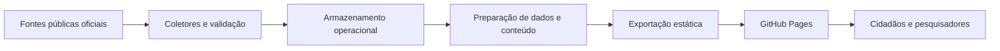

<div align="center">

# RUÍDO
### Observatório independente de transparência política brasileira

**Dados públicos. Linguagem clara. Fiscalização cidadã.**

[](https://ruido.runs-at.dev/)
[](https://github.com/leomoreiraa/ruido/tree/main/source)
[](https://github.com/leomoreiraa/ruido)

**[Explorar o site](https://ruido.runs-at.dev/) · [Entender a metodologia](https://ruido.runs-at.dev/sobre/) · [Ver cobertura](https://ruido.runs-at.dev/cobertura/)**

</div>

---

## Sobre o projeto

O **RUÍDO** é uma plataforma independente de acompanhamento da política brasileira. Seu objetivo é transformar registros públicos dispersos em informação **acessível, rastreável e contextualizada**, facilitando a fiscalização cidadã.

O projeto combina engenharia de dados, automação, desenvolvimento web e recursos de inteligência artificial para organizar informações sem substituir os documentos oficiais.

> **O dado é público. A leitura também deve ser.**

## Funcionalidades

- **Parlamentares:** consulta de perfis e registros públicos associados à atuação parlamentar.
- **Pautas e proposições:** acompanhamento de matérias legislativas e informações de tramitação.
- **Votações e presença:** visualização de registros disponíveis, respeitando os limites de cobertura de cada fonte.
- **Emendas e dados públicos:** organização de informações financeiras e institucionais quando disponibilizadas pelas fontes.
- **Leitura simplificada:** explicações assistidas por IA, preservando o acesso ao conteúdo original.
- **Cobertura e rastreabilidade:** indicação de lacunas e limites dos dados, sem tratar ausência de registro como resultado negativo.

> A disponibilidade de cada informação varia conforme a fonte, a legislatura e a etapa de coleta.

## Arquitetura e tecnologias

| Camada | Tecnologias / abordagem |
| --- | --- |
| Interface | React, Next.js, TypeScript |
| Publicação | Exportação estática e GitHub Pages |
| Ingestão | Coletores e integrações com APIs públicas |
| Automação | GitHub Actions no ambiente operacional privado |
| Persistência operacional | SQLite |
| IA | Processamento automatizado fora do navegador |
| Auditoria | Código-fonte público em [`source/`](./source/) |

### Fluxo de dados



**Separação entre código e operação:** este repositório publica o site e um espelho auditável do código-fonte em [`source/`](./source/). O banco SQLite operacional, credenciais, checkpoints, históricos internos e configurações privadas de execução não fazem parte do espelho público. O código em `source/` não é executado diretamente pelo GitHub Pages.

## Fontes e princípios de integridade

O projeto trabalha com dados públicos de instituições como **Câmara dos Deputados, Senado Federal, Controladoria-Geral da União, IBGE, PNUD/FJP e Banco Central**, de acordo com a disponibilidade das respectivas integrações.

A interpretação dos dados segue três princípios:

1. **Ausência de dado não significa zero.**
2. **Voto não nominal não pode ser atribuído individualmente sem registro.**
3. **Cobertura parcial não deve ser apresentada como histórico completo.**

Resumos gerados com apoio de IA são auxiliares de leitura e **não substituem a fonte primária**, nem constituem afirmações conclusivas sobre pessoas ou processos.

## Estrutura do repositório

```text
ruido/
├── index.html          # Entrada do site publicado
├── 404.html            # Página de erro personalizada
├── source/             # Espelho público do código-fonte
└── README.md           # Documentação do projeto
```

Outros diretórios e arquivos estáticos são produzidos conforme a exportação do site.

## Objetivo e impacto

O RUÍDO foi criado para diminuir a distância entre a informação institucional e a população. A proposta é facilitar consultas, apoiar pesquisas e incentivar o acompanhamento crítico da atividade legislativa, sem filiação partidária institucional.

**Público de interesse:** cidadãos, estudantes, jornalistas, pesquisadores e desenvolvedores interessados em transparência pública e tecnologia cívica.

## Contribuições e contato

Encontrou uma inconsistência, problema de acessibilidade ou oportunidade de melhoria? Utilize as [issues do GitHub](https://github.com/leomoreiraa/ruido/issues) para registrar a sugestão com contexto e, quando possível, a fonte correspondente.

**Desenvolvimento:** [Leonardo Moreira](https://github.com/leomoreiraa)

---

<div align="center">

**TRANSPARÊNCIA NÃO DEVERIA EXIGIR CONHECIMENTO TÉCNICO.**

[**ACESSAR RUÍDO ↗**](https://ruido.runs-at.dev/)

</div>
