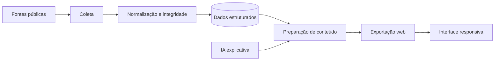

# Arquitetura do RUÍDO

[← Documentação](./README.md)

## Visão geral

A aplicação combina **Next.js 14, React 18 e TypeScript**, serviços de integração e transformação de dados, persistência com **Prisma e SQLite**, rotinas de processamento e exportação de conteúdo para navegação na web.

Este é um **diagrama conceitual**, não um mapa de infraestrutura.

## Camadas

| Camada | Código | Responsabilidade |
| --- | --- | --- |
| Páginas | [source/app](../source/app/) | Rotas, layouts e navegação |
| Componentes | [source/components](../source/components/) | Filtros, cartões, gráficos e visualizações |
| Serviços | [source/lib](../source/lib/) | Regras de domínio e integrações |
| Endpoints Next.js | [source/app/api](../source/app/api/) | Rotas de API da aplicação |
| Processamento | [source/scripts](../source/scripts/) | Coleta, transformação e exportação |
| Modelo de dados | [source/prisma](../source/prisma/) | Entidades e relações persistidas |

## Fluxo de informação

1. **Aquisição:** leitura de dados das fontes institucionais.
2. **Normalização:** padronização de formatos e identificação das entidades.
3. **Integridade:** tratamento de registros parciais, inconsistências e lacunas.
4. **Persistência:** organização relacional de dados para consulta e processamento.
5. **Enriquecimento:** preparação de indicadores e textos explicativos quando disponíveis.
6. **Publicação:** disponibilização de conteúdo processado para a interface.
7. **Consulta:** páginas responsivas com filtros e visualizações.

## Publicação estática

O código contempla um fluxo de exportação estática. Isso permite servir páginas pré-processadas sem executar coletores ou modelos de IA no navegador. **Uma rota de API presente no código Next.js não significa que esteja disponível como endpoint dinâmico no site estático.**

## Decisões de modelagem

Identificadores de parlamentares, proposições e votações devem ser interpretados com a instituição de origem. Datas, filiações, mandatos e indicadores precisam preservar seu contexto temporal.

Consulte [Dados e metodologia](./dados-e-metodologia.md).

## Segurança

A documentação descreve responsabilidades e estruturas de software sem divulgar credenciais, valores de configuração, parâmetros de automação ou informações administrativas de implantação.
