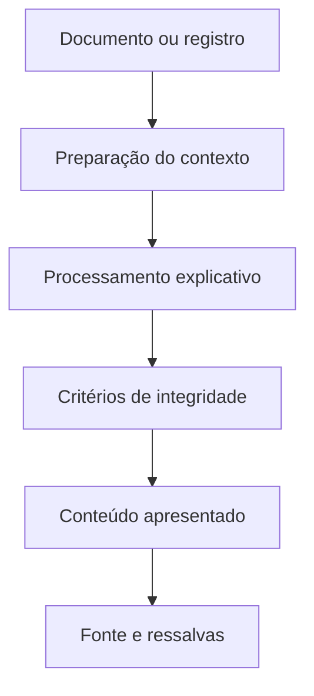

# Inteligência artificial e conteúdo explicativo

[← Documentação](./README.md)

## Finalidade

O RUÍDO utiliza processamento automatizado e recursos de IA para tornar textos e registros públicos mais compreensíveis. **IA não é fonte primária** e não substitui documentos oficiais ou análise jurídica.

## Fluxo conceitual

O diagrama representa responsabilidades do sistema, **não certifica revisão humana individual de cada resultado**.

## Aplicações

- Simplificação e explicação de proposições legislativas.
- Sínteses de registros e contextualização de conteúdos extensos.
- Organização temática de discursos e informações públicas.
- Apoio à apresentação de notícias, quando existirem referências suficientes.

A disponibilidade depende do módulo, da fonte e do registro.

## Princípios de confiabilidade

1. Não inventar fontes, citações ou fatos.
2. Distinguir documento oficial, reportagem e texto interpretativo.
3. Não atribuir culpa por associação, menção ou coincidência de nomes.
4. Preservar datas e contexto jurídico.
5. Sinalizar incerteza, ausência de informação e cobertura parcial.
6. Preferir fontes primárias quando houver divergências.

## Limitações

Modelos de linguagem podem omitir ressalvas, interpretar mal documentos ou produzir informações incorretas. A existência de um resumo **não garante verificação humana, completude ou atualização**.

## Código e correções

O código relacionado pode ser examinado em [source/lib](../source/lib/) e [source/scripts](../source/scripts/). Esta documentação não divulga credenciais, parâmetros de execução nem configurações de serviços.

Para reportar uma saída problemática, [abra uma issue](https://github.com/leomoreiraa/ruido/issues) com URL, trecho e fonte de comparação.
